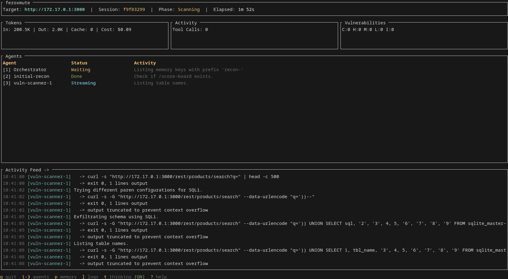

# feroxmute

LLM-powered penetration testing framework with autonomous agents.

> ⚠️ **Vibecoded and under heavy development.** Expect breaking changes, rough edges, and the occasional chaos.

feroxmute automates security testing using a hierarchy of specialized AI agents. An orchestrator plans the engagement and delegates to recon, scanner, exploit, and report agents - all executing tools inside a Kali Linux Docker container while you watch from a terminal UI.



## Features

- **Hierarchical agent architecture** - Orchestrator delegates to specialist agents (recon, scanner, exploit, report, script)
- **Multi-provider LLM support** - Anthropic, OpenAI, Gemini, Cohere, xAI, DeepSeek, Azure, Perplexity, Ollama, and LiteLLM (powered by [rig](https://github.com/0xPlaygrounds/rig)). Tested primarily with Gemini 3 Pro and Gemini 3 Flash.
- **CLI agent providers** - Drive [Claude Code](https://docs.anthropic.com/en/docs/claude-code), [Codex](https://github.com/openai/codex), or [Gemini CLI](https://github.com/google-gemini/gemini-cli) as LLM backends via the [Agent Client Protocol](https://github.com/anthropics/agent-client-protocol) (ACP). Tools are exposed over an ephemeral MCP server.
- **Docker isolation** - All tools run inside a Kali Linux container
- **Terminal UI** - Live dashboard showing agent activity, tool output, and findings
- **Session persistence** - SQLite-backed state with resumable sessions
- **Agent memory** - Persistent scratchpad for orchestrator context (press `p` in TUI to view)
- **SAST support** - Link source code to web targets for combined analysis
- **Engagement controls** - Passive mode, port restrictions, rate limiting, scope limitations

## Vulnerability Playbooks

Agents have access to 17 specialized playbooks that guide testing for specific vulnerability classes. Scanner and exploit agents can request playbooks using the `get_playbook` tool when they identify potential attack vectors.

Each playbook includes:
- **Indicators** - Signs the vulnerability may be present
- **Tools & commands** - Specific tool usage for the vulnerability type
- **Exploitation techniques** - Manual and automated approaches
- **Evasion methods** - WAF/filter bypass techniques where applicable

### Available Playbooks

**Injection**
- SQL Injection, NoSQL Injection, Command Injection, SSTI, XXE

**Client-Side**
- XSS, CSRF

**Server-Side**
- SSRF, LFI/RFI, Deserialization, Race Conditions

**Authentication & Crypto**
- JWT Attacks, Crypto Weaknesses

**Protocols & Platforms**
- GraphQL, WebSockets, Windows Web, Windows AD

## Quick Start

### Prerequisites

- Rust toolchain (1.75+)
- Docker running
- API key for your LLM provider (e.g., `ANTHROPIC_API_KEY`)
- For CLI agent providers: the CLI binary installed and authenticated (see [CLI Agent Providers](#cli-agent-providers))

### Installation

```bash
git clone https://github.com/dilaz/feroxmute
cd feroxmute
cargo build --release
```

### Setup

```bash
# Interactive configuration wizard
./target/release/feroxmute --wizard
```

This creates `~/.feroxmute/config.toml` with your provider settings.

#### Reasoning effort (OpenAI-compatible providers)

Set `reasoning_effort` in `~/.feroxmute/config.toml` (or the local
`feroxmute.toml`, which takes precedence). For OpenRouter:

```toml
[provider]
name = "openai"
model = "z-ai/glm-5.3-flash"
base_url = "https://openrouter.ai/api/v1"
api_key = "${OPENROUTER_API_KEY}"
reasoning_effort = "low"
```

Override the configured effort for a run:

```bash
./target/debug/feroxmute --target example.com --reasoning-effort high
```

Accepted values: `none`, `minimal`, `low`, `medium`, `high`, `xhigh`, `max`.
Supported levels depend on the model: GLM 5.3 Flash supports `low`, `high`,
and `max`, with mandatory reasoning, so do not use `none` for that model.
Omitting the setting preserves the model/provider default; `none` explicitly
requests disabled reasoning where supported. CLI values override TOML values.

This option applies to `openai` and `litellm` providers, including every
specialist using the engagement provider. Other providers reject an explicit
setting. OpenRouter receives `reasoning.effort`; other compatible endpoints
receive `reasoning_effort`. A separately configured `[target_llm]` can set its
own effort; it does not inherit the engagement's CLI override.

See [OpenRouter reasoning documentation](https://openrouter.ai/docs/guides/best-practices/reasoning-tokens).

### Run

```bash
# Start an engagement (Kali container builds automatically on first run)
./target/release/feroxmute --target example.com
```

## Usage

```bash
feroxmute [OPTIONS] --target <TARGET>
```

| Flag | Description |
|------|-------------|
| `--target <URL>` | Target URL or IP |
| `--provider <NAME>` | LLM provider (anthropic, openai, gemini, ollama, claude-code, codex, gemini-cli, etc.) |
| `--model <MODEL>` | Override default model |
| `--reasoning-effort <LEVEL>` | Override reasoning effort for OpenAI-compatible providers |
| `--cli-path <PATH>` | Path to CLI agent binary (for claude-code, codex, gemini-cli providers) |
| `--passive` | Passive reconnaissance only, no active scanning |
| `--sast-only` | Source code analysis only, no web testing |
| `--source <PATH>` | Link source code directory to target |
| `--discover` | Enable subdomain enumeration and asset discovery |
| `--portscan` | Enable port scanning (naabu, nmap) |
| `--network` | Enable network-level scanning beyond HTTP |
| `--no-exploit` | Disable exploitation phase |
| `--ports <LIST>` | Limit to specific ports (e.g., `80,443,8080`) |
| `--rate-limit <N>` | Max requests per second |
| `--instruction <TEXT>` | Custom objective for the orchestrator |
| `--resume <PATH>` | Resume a previous session |
| `--wizard` | Interactive setup |
| `-v`, `-vv`, `-vvv` | Increase verbosity |

### Examples

```bash
# Default: Test a web application thoroughly (no discovery, no portscan)
feroxmute --target https://app.example.com

# Enable subdomain discovery for broader coverage
feroxmute --target example.com --discover

# Full network penetration test
feroxmute --target 10.0.0.0/24 --discover --portscan --network

# Combine web target with source code analysis
feroxmute --target https://app.example.com --source ./src

# Source code analysis only
feroxmute --sast-only --target ./my-project

# Use Claude Code as the LLM backend
feroxmute --target https://app.example.com --provider claude-code

# Use Codex with a custom codex-acp adapter path
feroxmute --target https://app.example.com --provider codex --cli-path /usr/local/bin/codex-acp

# Use Gemini CLI
feroxmute --target https://app.example.com --provider gemini-cli
```

## CLI Agent Providers

Instead of calling LLM APIs directly, feroxmute can drive CLI-based AI agents as backends. This uses the [Agent Client Protocol (ACP)](https://github.com/anthropics/agent-client-protocol) to communicate with the agent over stdin/stdout, and exposes feroxmute's tools via an ephemeral [MCP](https://modelcontextprotocol.io/) HTTP server.

### How It Works

1. feroxmute spawns the CLI agent as a subprocess
2. An MCP HTTP server starts on a random local port with bearer token authentication
3. The CLI agent connects to the MCP server to access feroxmute's tools (shell, findings, memory, orchestrator, report)
4. Communication follows the ACP JSON-RPC protocol over stdin/stdout

### Supported CLI Agents

| Provider | Binary | Auth |
|----------|--------|------|
| `claude-code` | [`claude-agent-acp`](https://www.npmjs.com/package/@agentclientprotocol/claude-agent-acp) (from `@agentclientprotocol/claude-agent-acp`) | `ANTHROPIC_API_KEY` or `claude login` |
| `codex` | [`codex-acp`](https://github.com/zed-industries/codex-acp) | `OPENAI_API_KEY`, `CODEX_API_KEY`, or existing Codex auth |
| `gemini-cli` | `gemini` | `gemini auth` |

> Install the Claude Code adapter with `bun install -g @agentclientprotocol/claude-agent-acp`.
> With `claude-agent-acp` on your `$PATH`, `--provider claude-code` uses it automatically.

For `claude-code`, the engagement's configured model overrides Claude's saved
model preference. Feroxmute pins it when launching the adapter and waits for
ACP model selection to succeed before making each session available for prompts.
An invalid or rejected model stops session setup rather than using the adapter's
default. Use the exact model ID supported by Claude (for example,
`claude-opus-4-8`, not `claude-opus-4.8`).

### Custom Binary Path

If the CLI agent binary isn't on your `$PATH`, use `--cli-path`:

```bash
feroxmute --target example.com --provider claude-code --cli-path ~/.bun/bin/claude-agent-acp
feroxmute --target example.com --provider codex --cli-path ~/bin/codex-acp
```

## Docker

The Kali container builds automatically on first run. For manual control:

```bash
# Build the Kali image
docker compose -f docker/compose.yml build

# Start containers
docker compose -f docker/compose.yml up

# Start with LiteLLM proxy sidecar
docker compose -f docker/compose.yml --profile litellm up
```

## Disclaimer

This tool is intended for **authorized security testing only**.

- Only use against systems you own or have explicit written permission to test
- You are solely responsible for your actions
- The authors accept no liability for misuse or damage caused by this software
- This software comes with **absolutely no warranty**

**Use at your own risk.**

## License

BSD 3-Clause License. See [LICENSE](LICENSE) for details.
